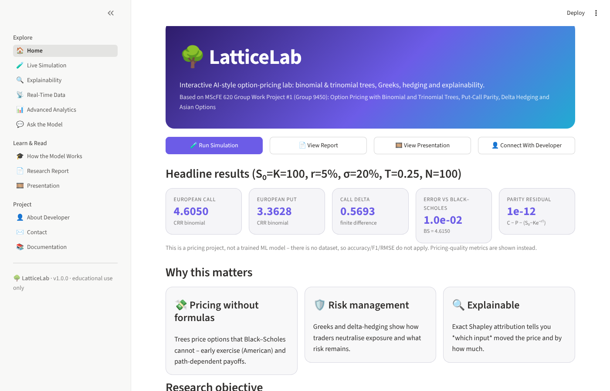
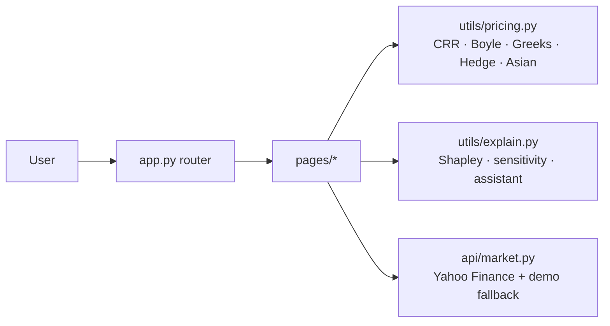

<div align="center">

# 🌳 LatticeLab

**Interactive option-pricing lab: binomial & trinomial trees, Greeks, delta hedging, Asian options and explainability.**

     


</div>

> Based on **MScFE 620 Derivative Pricing – Group Work Project #1 (Group 9450)**: *Option Pricing with Binomial and Trinomial Trees, Put–Call Parity, Delta Hedging and Asian Options.*

## ✨ Features
- **Live Simulation** – manual inputs, CSV batch upload, multi-scenario comparison, Greeks, plain-language interpretation
- **Explainability** – exact Shapley attribution, global importance, sensitivity, correlation, what-if
- **Real-Time Data** – free Yahoo Finance data, caching, auto-refresh, automatic demo-mode fallback
- **Advanced Analytics** – convergence vs Black–Scholes, strike study, hedging simulator, Asian option, error distribution
- **Ask the Model** – built-in assistant (no API key)
- **Learn**, **Research Report** (embedded PDF), **15-slide Presentation** (PPTX/PDF), **About**, **Contact**, **Documentation**
- Responsive, light/dark friendly UI; prominent educational disclaimer on every page

> ℹ️ This is a quantitative-finance project, **not supervised ML**: there is no dataset, so accuracy/F1/RMSE do not apply. Quality is measured by error vs Black–Scholes, parity residuals and no-arbitrage bounds.

## 🚀 Installation
```bash
git clone REPOSITORY_URL && cd latticelab
python -m venv .venv && source .venv/bin/activate
pip install -r requirements.txt
streamlit run app.py
```
Tests: `pytest -q` · Rebuild deck: `python ppt/build_ppt.py`

## 🧭 Usage
Open the sidebar → pick a page. Start with **Live Simulation**, then **Explainability**.

## 🏗️ Architecture


## 🧰 Tech stack
Python 3.11 · NumPy · SciPy · pandas · Streamlit · Plotly · yfinance · python-pptx · pytest · Docker

## 📊 Results (S₀=K=100, r=5 %, σ=20 %, T=0.25, N=100)
| Metric | Value |
|---|---|
| European call / put | 4.6050 / 3.3628 |
| Delta call / put | 0.5693 / −0.4307 |
| Vega | 19.62 per 1.00σ (0.196 per vol-pt) |
| Black–Scholes call | 4.6150 (binomial error −0.010) |
| American puts K=90…110 | 0.56, 1.58, 3.47, 6.43, 10.33 |
| Asian put (MC, control variate) | ≈ 2.02 |

Original binomial/American results are reproduced **exactly**; see *Documentation → Audit* for defects found in the source notebook/report (trinomial-European bug, invalid Asian value, synthetic hedging table) and how they were fixed.

## ☁️ Deployment
Step-by-step guides for GitHub, Streamlit Cloud, Hugging Face Spaces, Render, Railway, Replit and Docker: [`deployment.md`](deployment.md).
```bash
docker build -t ai-project .
docker run -p 8501:8501 ai-project
```

## 📁 Structure
`app.py` · `pages/` · `utils/` · `api/` · `ppt/` · `reports/` · `documentation/` · `data/` · `models/` · `assets/` · `streamlit_config/` · `tests/`

## 📚 References
- Cox, Ross & Rubinstein (1979), *Option pricing: a simplified approach*
- Boyle (1986), *Option valuation using a three-jump process*
- Black & Scholes (1973); Kemna & Vorst (1990) – geometric Asian
- Hull, *Options, Futures and Other Derivatives*

## ⚠️ Disclaimer
This application is developed for educational, research, and demonstration purposes only. The predictions, insights, analyses, and recommendations generated by this system should not be considered financial, investment, legal, medical, or professional advice. Users should consult qualified professionals before making decisions based on the results provided by this application. The developer assumes no responsibility for actions taken based on information produced by this platform.

## 👤 Author
Ajeet Kumar · [ajeetk095@gmail.com](mailto:ajeetk095@gmail.com)
